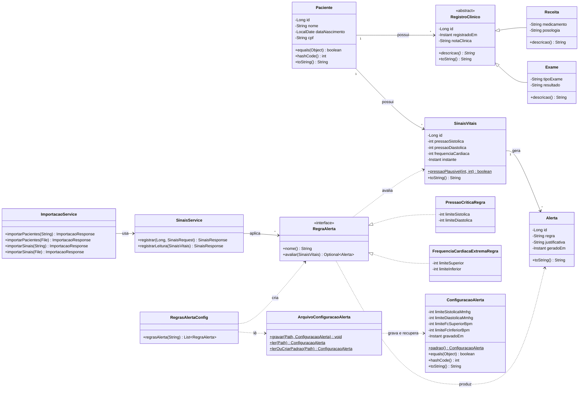

# Diagrama de classes

Pacote base `com.health.prontuario`. Os métodos de acesso (getters) foram omitidos para manter o diagrama legível.

## Leitura rápida

- **Herança:** `Exame` e `Receita` especializam `RegistroClinico`, que declara `descricao()` abstrato; cada subclasse sobrescreve.
- **Polimorfismo:** `SinaisService` recebe uma `List<RegraAlerta>` e aplica cada regra pelo mesmo contrato, sem saber qual é.
- **TAD:** `ConfiguracaoAlerta` tem estado privado, validado no construtor, sem setters.
- **Sobrecarga:** `ImportacaoService` oferece `importarPacientes` e `importarSinais` com `String` e com `File`.
- **Omitidos:** controllers, repositórios, DTOs e exceções. Seguem o padrão controller → service → repository.